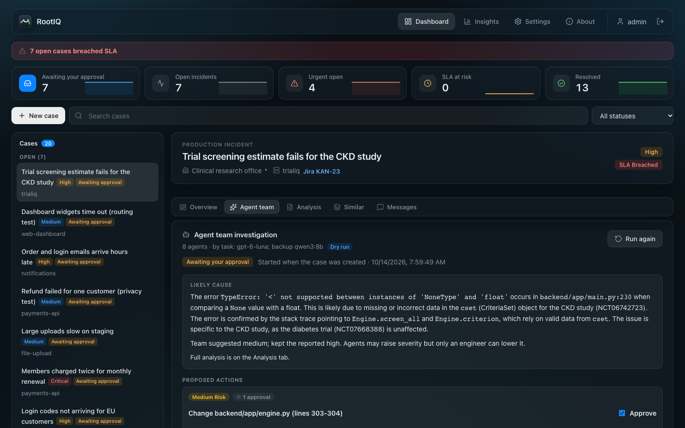
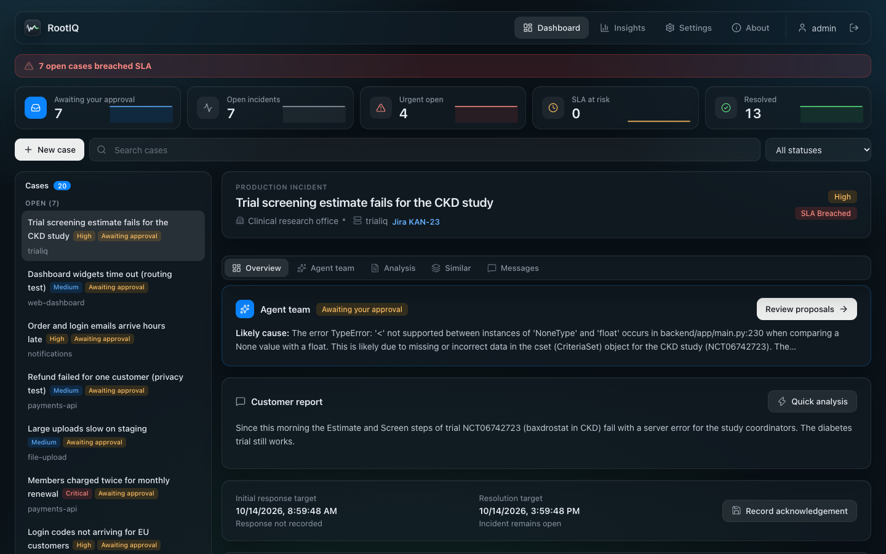
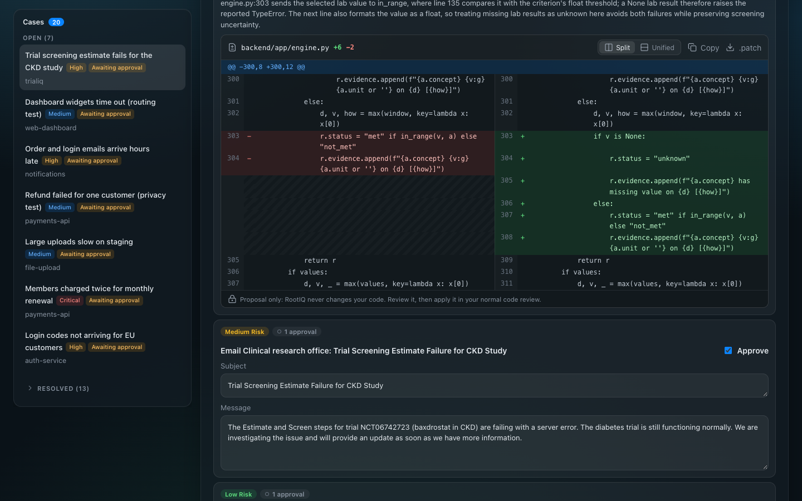
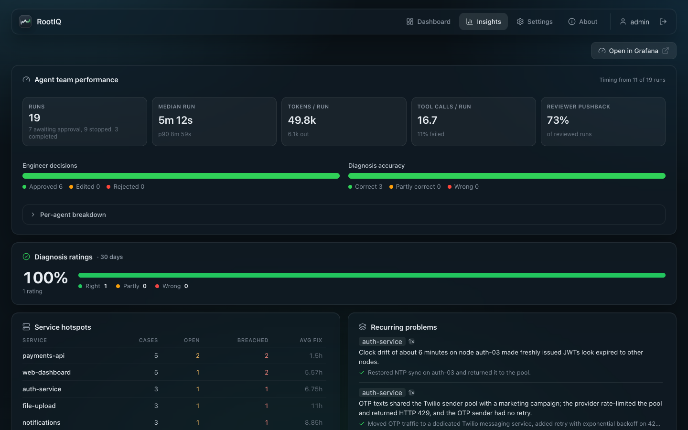
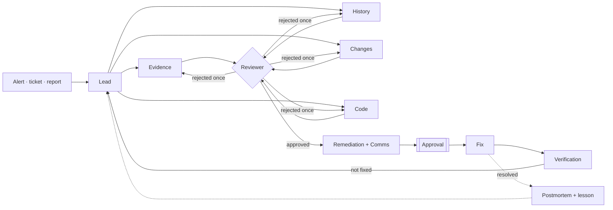

# RootIQ


[](LICENSE)

When a production service breaks, RootIQ sends a team of AI agents to find out why. They read the logs, metrics,
recent deploys, the code and the database, compare the case with past incidents, and propose a fix. Nothing leaves
the system until one or two engineers approve it. After the fix, an agent checks that the errors really stopped.



## An incident, start to finish

A team run takes about 3 minutes with the local model `qwen3:8b`, plus the time a person needs to approve.

| Stage | What happens |
| --- | --- |
| Trigger | A Grafana alert, a Jira ticket or a customer report opens a case, and the team starts |
| Plan | The lead agent writes hypotheses and gives each specialist a task |
| Investigate | Four specialists work at the same time: **Evidence** quotes log lines and metrics, **History** finds look-alike incidents, **Changes** lists the deploys before the first error, **Code** follows the stack trace into the source |
| Review | The reviewer checks each claim against the raw tool output and can send weak work back one time |
| Propose | Remediation picks a fix from a safe catalog; Comms drafts the customer email and the Jira comment |
| Approve | An engineer approves, edits or rejects each proposal. An admin sets one or two approvals for each risk level |
| Verify | At 90 s, 3 min and 6 min after the fix, verification compares the errors before and after. If the errors continue, a new run starts |
| Learn | A postmortem from the recorded facts, and a lesson that the lead reads on the next similar case |

Other AI tools, such as Claude Desktop or Claude Code, can start an investigation through the MCP server.

## Does it work?

20 incidents with known causes, the same local model for every method, scored by a fixed rubric.
[Full report](reports/evals-20261002-1426.md).

|| One prompt | Single agent | Agent team |
| --- | --- | --- | --- |
| Correct root cause | 4/20 | 11/20 | **16/20** |
| Look-alike past incident: correct / copied | 1/5 / 0 | 2/5 / **2 copied** | **5/5 / 0 copied** |
| Cause only in the log lines near the errors | 0/5 | 1/5 | **4/5** |
| Quotes log evidence with times | 0% | 41% | **94%** |
| Said "unknown" when there was no evidence | **2/3** | 1/3 | 1/3 |
| Median time / tokens per incident | 32 s / n/a | 43 s / 11.4k | 162 s / 21.7k |

The evaluation also caught a real bug. On an incident with no evidence, the team invented an incident ID and ran for
30 minutes. Code now rejects any ID that no tool returned, and each run has a time and call limit. The same incident
then ended in about 3 minutes with a warning ([report](reports/evals-20261002-2052.md)). One weak point remains: with
no evidence, the 8B model still guesses a cause in 2 of 3 cases.

| Dashboard | Code patch | Insights |
| --- | --- | --- |
|  |  |  |

## Guardrails

| Risk | Control |
| --- | --- |
| The model invents evidence | Code rejects quoted log lines that no log holds, and IDs that no tool returned |
| An agent takes a harmful action | Fixes come only from a catalog: roll back, revert a config, restart, scale, purge a CDN, turn off a flag. Dry run is on by default |
| A fix runs twice | A run-once key, rate limits and a kill switch |
| The team hides a severe problem | Agents can raise the severity, never lower it |
| Secrets leak to a model | The code tools never open `.env` files, keys or `.git`, and mask secrets in code. Emails, card and phone numbers are masked before any cloud call |
| A model provider fails | Each task has a chain of models: Groq, Gemini, Claude, GPT or Grok, and a local Ollama model as the last backup |

## Connect your stack

| Data | Sources |
| --- | --- |
| Logs | Grafana Loki, Elasticsearch or OpenSearch, AWS CloudWatch Logs, or demo files |
| Metrics | Prometheus |
| Changes | GitHub commits and releases |
| Code | A local folder or GitHub, read-only |
| Database | PostgreSQL or SQLite, read-only, one SELECT at a time with a 5 s limit |
| Tickets and email | Jira, two-way; Gmail drafts |

Set them on **Settings > Data sources**. A source is saved only after its connection test passes.

## Setup

Python 3.11+, Node.js 18+ and [Ollama](https://ollama.com):

```bash
ollama pull qwen3:8b && ollama pull nomic-embed-text
python3 -m venv .venv && source .venv/bin/activate
pip install -r backend/requirements.txt
cp backend/.env.example backend/.env          # set ROOTIQ_AUTH_USERNAME and _PASSWORD
python -m backend.seed.seed_demo               # demo incidents and service logs
cd frontend && npm install && cd ..
./run.sh                                       # http://127.0.0.1:5174
```

For a team, `docker compose up -d --build` runs PostgreSQL, the API, agent workers and the website
([deploy guide](docs/deploy.md)). Every setting is in [docs/configuration.md](docs/configuration.md), and the MCP setup
is in [docs/mcp-setup.md](docs/mcp-setup.md).

Tests: `python -m pytest backend/tests` runs 254 offline tests with a scripted model, plus 32 on PostgreSQL.
`python -m backend.evals.run_evals` runs the evaluation above. CI runs both, and fails if the agent team's score
drops more than 0.10 below the baseline.

## Agent graph



Each run is a LangGraph thread with a SQLite or PostgreSQL checkpointer, so a run waiting for approval survives a
restart. The code is in `backend/app/agent/`; the website is React and TypeScript in `frontend/`.
